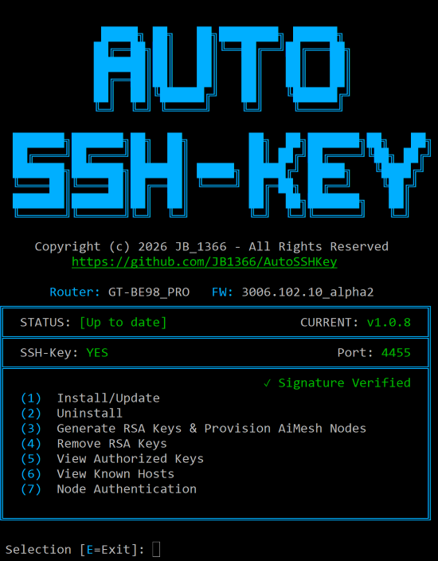

$\color{blue}{\Large\text{AutoSSHKey - available on AMTM!}}$<br>
**Developer:** JB_1366<br><br>

$\color{blue}{\Large\text{Install:}}$
```
curl -sfL https://raw.githubusercontent.com/JB1366/AutoSSHKey/main/autosshkey.sh \
-o /tmp/autosshkey.sh && sh /tmp/autosshkey.sh
```
$\color{blue}{\Large\text{Release public key:}}$
```
-----BEGIN PUBLIC KEY-----
MCowBQYDK2VwAyEAEdtCIawanvftpEaWarAijfbjyZB8U4siBZY7C48X23Y=
-----END PUBLIC KEY-----
```
$\color{blue}{\Large\text{SHA-256 Fingerprint:}}$
```
00806c045ca3d3d6a4c4bda1231eed057df0991a3a9a2680693cc658edd8d25a
```
\
\

